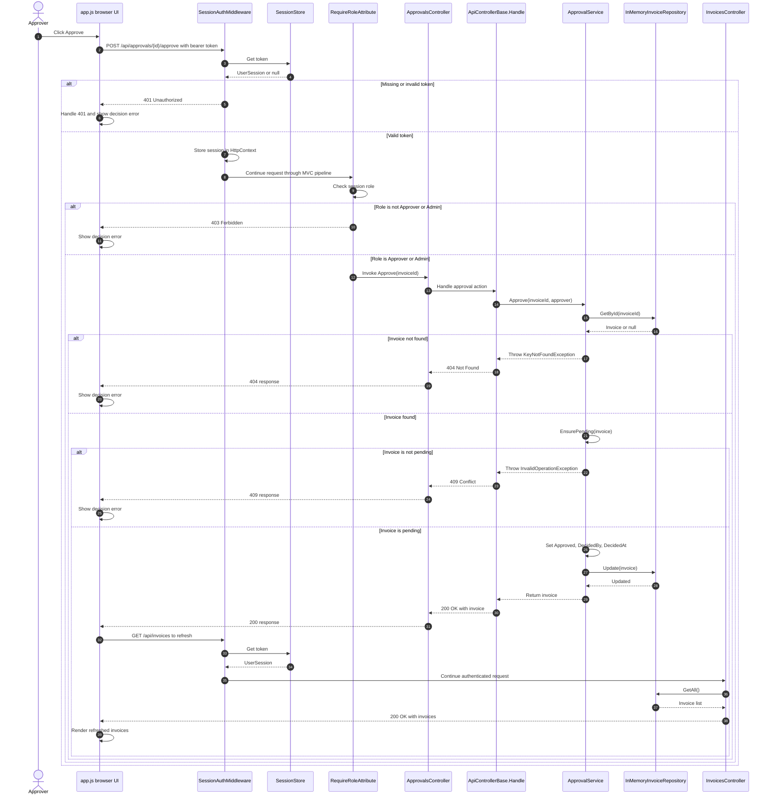

# Approval Sequence

## Citation Table

| Ref | Element or Arrow | Location | Symbol |
|------|-----------------|----------|---------|
| S1 | Approver clicks Approve | `backend/src/InvoiceApp.Api/wwwroot/app.js:72` | `approve.addEventListener('click', () => decide(...))` |
| S2 | UI sends approval POST | `backend/src/InvoiceApp.Api/wwwroot/app.js:82-85,16-19` | `decide(path, payload)` posts via `api`; `fetch(`/api${path}`...)` |
| S3 | UI attaches bearer token to API request | `backend/src/InvoiceApp.Api/wwwroot/app.js:18-19` | Sets `headers.Authorization` before `fetch(...)`. |
| S4 | Middleware checks protected API request | `backend/src/InvoiceApp.Api/Auth/SessionAuthMiddleware.cs:16-25` | `InvokeAsync`; `needsSession`; `_sessions.Get(token)` |
| S5 | SessionStore token lookup | `backend/src/InvoiceApp.Api/Auth/SessionStore.cs:18-19` | `Get(string? token)`; `_sessions.TryGetValue(...)` |
| S6 | Missing/invalid token returns 401 | `backend/src/InvoiceApp.Api/Auth/SessionAuthMiddleware.cs:27-31` | `if (session is null)`; `Status401Unauthorized` |
| S7 | Valid session stored for downstream request | `backend/src/InvoiceApp.Api/Auth/SessionAuthMiddleware.cs:33,36` | `context.Items[...] = session`; `_next(context)` |
| S8 | Role filter checks role and returns 403 | `backend/src/InvoiceApp.Api/Auth/RequireRoleAttribute.cs:17,21-23` | `OnActionExecuting`; role membership check; `Status403Forbidden` |
| S9 | ApprovalsController role restriction | `backend/src/InvoiceApp.Api/Controllers/ApprovalsController.cs:8-10` | `[RequireRole("Approver", "Admin")]`; `ApprovalsController` |
| S10 | Approval controller action | `backend/src/InvoiceApp.Api/Controllers/ApprovalsController.cs:22-23` | `Approve(string invoiceId)`; `Handle(() => _approvals.Approve(...))` |
| S11 | Handle invokes supplied action | `backend/src/InvoiceApp.Api/Controllers/ApiControllerBase.cs:9-13` | `Handle(Func<Invoice> action)`; `return Ok(action())` |
| S12 | ApprovalService approval method | `backend/src/InvoiceApp.Domain/ApprovalService.cs:31-34` | `Approve(...)`; `Find(invoiceId)`; `EnsurePending(invoice)` |
| S13 | Service reads invoice | `backend/src/InvoiceApp.Domain/ApprovalService.cs:61-63`; `backend/src/InvoiceApp.Api/InMemoryInvoiceRepository.cs:25-27` | `_repository.GetById(invoiceId)`; `FirstOrDefault(...)` |
| S14 | Missing invoice exception | `backend/src/InvoiceApp.Domain/ApprovalService.cs:61-63` | `?? throw new KeyNotFoundException(...)` |
| S15 | Handle maps not found to 404 | `backend/src/InvoiceApp.Api/Controllers/ApiControllerBase.cs:15-17` | `catch (KeyNotFoundException)`; `return NotFound(...)` |
| S16 | Service validates pending status | `backend/src/InvoiceApp.Domain/ApprovalService.cs:34,65-71` | `EnsurePending(invoice)` checks `InvoiceStatus.PendingApproval` |
| S17 | Invalid state exception | `backend/src/InvoiceApp.Domain/ApprovalService.cs:67-70` | `throw new InvalidOperationException(...)` |
| S18 | Handle maps invalid operation to 409 | `backend/src/InvoiceApp.Api/Controllers/ApiControllerBase.cs:19-21` | `catch (InvalidOperationException)`; `return Conflict(...)` |
| S19 | Service sets decision fields | `backend/src/InvoiceApp.Domain/ApprovalService.cs:36-38` | Sets `Status`, `DecidedBy`, `DecidedAt` |
| S20 | Service updates repository | `backend/src/InvoiceApp.Domain/ApprovalService.cs:39`; `backend/src/InvoiceApp.Api/InMemoryInvoiceRepository.cs:50-55` | `_repository.Update(invoice)`; implementation replaces matching entry |
| S21 | Successful response is 200 | `backend/src/InvoiceApp.Api/Controllers/ApiControllerBase.cs:13`; `backend/src/InvoiceApp.Api/Controllers/ApprovalsController.cs:22-23` | `return Ok(action())`; controller returns `Handle(...)` |
| S22 | UI handles unsuccessful response and displays error | `backend/src/InvoiceApp.Api/wwwroot/app.js:20-22,82-88` | 401 handling; `if (!response.ok) throw`; `showError('decision-error', ...)` |
| S23 | UI refreshes after success | `backend/src/InvoiceApp.Api/wwwroot/app.js:85-86` | `await api(...)`; `await refresh()` |
| S24 | UI requests invoices for refresh | `backend/src/InvoiceApp.Api/wwwroot/app.js:40-43` | `api('/invoices')`; `renderInvoices(invoices)` |
| S25 | InvoicesController reads all invoices | `backend/src/InvoiceApp.Api/Controllers/InvoicesController.cs:23-25` | `GetAll(...)`; `_repository.GetAll()` |
| S26 | Repository returns invoice list | `backend/src/InvoiceApp.Api/InMemoryInvoiceRepository.cs:20-23` | `GetAll()` returns `_invoices.ToList()` |
| S27 | UI renders refreshed invoices | `backend/src/InvoiceApp.Api/wwwroot/app.js:41-43,46-47` | `renderInvoices(invoices)`; updates invoices table body |
| S28 | Middleware installed in request pipeline | `backend/src/InvoiceApp.Api/Program.cs:21` | `app.UseMiddleware<SessionAuthMiddleware>()` |
| S29 | MVC controllers mapped | `backend/src/InvoiceApp.Api/Program.cs:22` | `app.MapControllers()` |
| S30 | User actor | No source file | External actor; no user caller symbol exists in the repository. |
