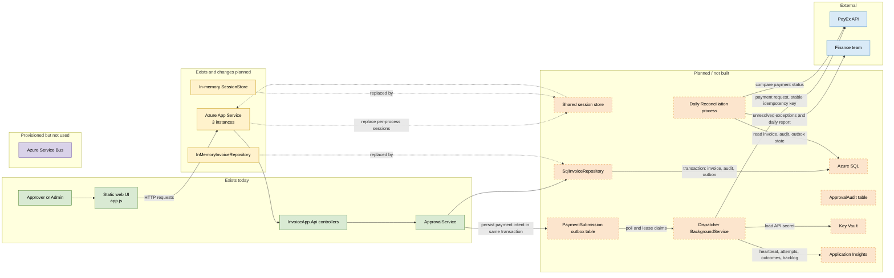
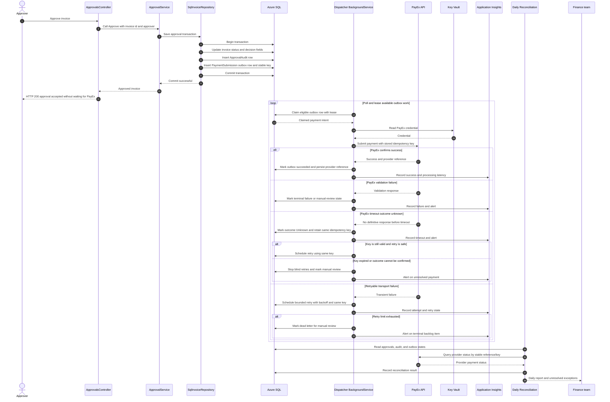

# Target state: once persistence and PayEx are in

Today, the application is an ASP.NET Core API with a static browser UI, `ApprovalService`, an in-memory invoice repository, and an in-memory bearer-session store. The target replaces volatile invoice storage with Azure SQL, commits approval/audit/payment intent together, and uses a background dispatcher to submit payments to PayEx. It also moves sessions to shared storage for three App Service instances and adds monitoring and daily reconciliation. **ADR-001: Exactly-once PayEx submission** selects Option B, the transactional outbox with a background worker; this is a target design, not implemented application behavior.

## Legend

- **Exists today** — present in application source now.
- **Exists and changes planned** — current component remains, but its implementation or hosting changes.
- **Planned / not built** — target component or behavior absent from current application code.
- **Provisioned but not used** — infrastructure is reported provisioned, but the selected target flow does not depend on it.
- **External dependency** — operated outside this application.

## Container view

The Service Bus is shown as provisioned but unused and intentionally has no message-flow arrows: the selected design has the dispatcher poll and claim SQL outbox rows. No Service Bus dependency is assumed for this target.

## Container Citation Table

| Element | Status | Source | Design rationale |
|---|---|---|---|
| Static web UI | Exists | `backend/src/InvoiceApp.Api/wwwroot/app.js`; `backend/src/InvoiceApp.Api/wwwroot/index.html` | Existing browser client presents invoices and submits approval requests. |
| InvoiceApp.Api controllers | Exists | `backend/src/InvoiceApp.Api/Controllers/InvoicesController.cs`; `ApprovalsController.cs`; `AuthController.cs` | Existing HTTP boundary; retained for the target workflow. |
| ApprovalService | Exists | `backend/src/InvoiceApp.Domain/ApprovalService.cs` | Existing domain service owns submit/approve/reject transitions. ADR-001 keeps approval rules in the domain while delivery becomes asynchronous. |
| In-memory SessionStore | Exists and changes planned | `backend/src/InvoiceApp.Api/Auth/SessionStore.cs`; `Program.cs` registers it singleton | Current process-local token store is not shared across instances; replace with a shared store for the three-instance target. |
| InMemoryInvoiceRepository | Exists and changes planned | `backend/src/InvoiceApp.Api/InMemoryInvoiceRepository.cs`; `Program.cs` registration | Current volatile repository is replaced by SQL persistence. |
| Azure App Service, 3 instances | Planned / not built | Target requirements supplied for this architecture; not established by current app code | Runs multiple API instances for the production deployment target. |
| Shared session store | Planned / not built | Target requirements; no current shared-store implementation | Keeps authentication sessions available across App Service instances. Specific product is intentionally unspecified. |
| SqlInvoiceRepository | Planned / not built | Target requirements; current repository is in-memory | Implements the existing repository abstraction against Azure SQL. |
| Azure SQL | Planned / not built | ADR-001, “Option B” and “Final Decision”; target requirements | Durable invoice, audit, and outbox persistence; provides the transaction boundary for approval intent. |
| PaymentSubmission outbox table | Planned / not built | ADR-001, “Option B - Transactional Outbox + Background Worker”; target requirements | Stores payment intent atomically with the approval and audit update, so delivery can resume after process failure. |
| ApprovalAudit table | Planned / not built | Target requirements; ADR-001’s seven-year auditability rationale | Persists approval decisions for audit retention. Table schema and retention implementation remain to be designed. |
| Dispatcher BackgroundService | Planned / not built | ADR-001, “Option B - Transactional Outbox + Background Worker”; target requirements | Claims and delivers pending outbox work with retry and operational monitoring. |
| PayEx API | External dependency | ADR-001, “Options Considered” and “Risks of the Selected Approach”; target requirements | External payment provider. Timeout is ambiguous; use provider idempotency/status capabilities before retrying uncertain outcomes. Support is not verified in the ADR. |
| Key Vault | Planned / not built | Target requirements; no current application integration | Stores the PayEx credential outside application source/configuration. |
| Application Insights | Planned / not built | ADR-001, “Operational Mitigations”; target requirements | Provides worker heartbeat, backlog-age, attempt, and outcome telemetry/alerts. |
| Daily Reconciliation process | Planned / not built | Target requirements; ADR-001 identifies ambiguous outcomes and recovery risk | Compares SQL payment records with PayEx status and reports unresolved differences to Finance. |
| Finance team | External | Target requirements | Receives exceptions and reconciliation reports for operational resolution. |
| Azure Service Bus | Provisioned but not used | `ops/incidents/INC-2047/servicebus-status.txt`; `ops/README.md` scenario note | Existing scenario evidence reports a provisioned topic. The chosen SQL-polling outbox design does not use it. |

## Sequence: approving an invoice

**Exactly-once boundary:** the SQL transaction makes the invoice decision, audit row, and outbox intent atomic. Delivery is retried and therefore may be at-least-once. Avoiding duplicate external payment effects depends on PayEx honoring the stable idempotency key or providing a status lookup; ADR-001 says PayEx support could not yet be verified. Do not blindly retry an ambiguous timeout after the provider’s key-retention window expires.

## What changes compared with today

| Today | Target state |
|---|---|
| `InMemoryInvoiceRepository` loses data on process restart | `SqlInvoiceRepository` persists invoice state in Azure SQL |
| In-memory `SessionStore` is local to one process | Shared session store serves all three App Service instances |
| Approval only changes invoice state in the current repository | Approval, `ApprovalAudit`, and `PaymentSubmission` outbox row commit in one SQL transaction |
| In-memory single-process assumptions | Lease-based SQL claims and shared persistence coordinate multiple instances |
| No persistent approval audit table in current code | `ApprovalAudit` stores approval decisions for the required retention period |
| No payment reconciliation process in current code | Daily reconciliation compares SQL state with PayEx and reports exceptions |
| No PayEx request in current code | Background dispatcher submits payment requests asynchronously after approval commits |

## Risks Removed

- **Lost data on restart:** durable invoice, audit, and payment-intent rows survive API process restarts.
- **Concurrent approvals:** SQL transaction/locking and lease-based work claims are designed to coordinate concurrent instances; isolation and conflict behavior still require implementation and tests.
- **Duplicate payment submission:** a stable idempotency key plus provider confirmation/reconciliation reduces duplicate effects; exactly-once external effects are not guaranteed until PayEx behavior is confirmed.
- **Session loss between instances:** shared session storage makes a session available to all instances, subject to the selected store's availability and consistency design.
- **External dependency latency:** the approval response no longer waits for PayEx; the outbox preserves the work for asynchronous delivery. PayEx delays still affect payment completion time.

## Architecture Principles

- **Domain isolation:** business transitions remain in `InvoiceApp.Domain`; API, SQL, and PayEx adapters stay outside the domain assembly.
- **Repository abstraction:** `IInvoiceRepository` remains the domain-facing persistence contract; the planned SQL repository implements it.
- **Dependency injection:** register SQL repository, dispatcher, clients, and shared-session integration through the host's service container rather than constructing them in controllers.
- **Transaction boundaries:** invoice update, audit insert, and outbox insert use one Azure SQL transaction. External PayEx calls happen after commit, never inside that transaction.
- **Exactly-once submission strategy:** durable outbox plus stable provider idempotency key and reconciliation. The database guarantees durable intent; external exactly-once behavior depends on PayEx semantics and must be verified.
- **Observability:** worker heartbeat, oldest pending age, Unknown count, attempt outcomes, and reconciliation exceptions feed Application Insights and actionable alerts.
